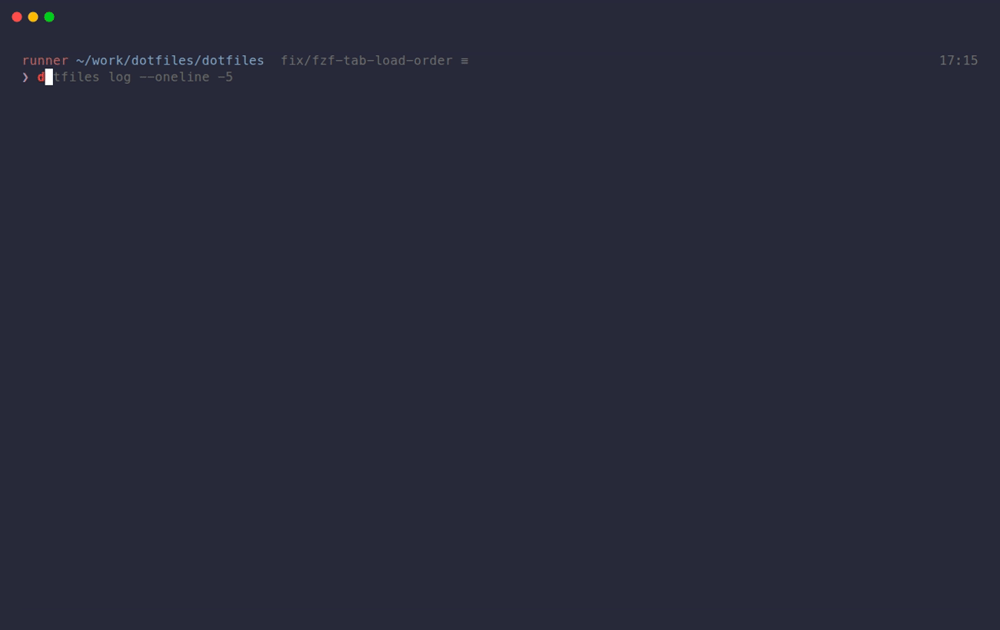

# dotfiles

Personal dotfiles managed with [GNU Stow](https://www.gnu.org/software/stow/). Each tool's config lives in its own package directory, symlinked into `$HOME`.

<p align="center">
  
</p>

## How it works

The repo lives at `~/.dotfiles/`. Each top-level directory is a *stow package* whose internal structure mirrors `$HOME`. Running `stow <package>` creates symlinks from `$HOME` into the repo:

```
~/.dotfiles/
├── zsh/
│   ├── .zshrc          → symlinked as ~/.zshrc
│   └── .zprofile       → symlinked as ~/.zprofile
├── git/
│   └── .config/git/    → symlinked as ~/.config/git/
├── fzf/
│   └── .config/fzf/    → symlinked as ~/.config/fzf/
├── oh-my-posh/
│   └── .config/zsh/oh-my-posh/
├── agents/
│   └── .agents/        → shared instructions and portable skills
├── claude/
│   └── .claude/        → symlinked as ~/.claude/
├── macos/
│   └── .config/macos/
└── installers/         (not stowed — installer scripts only)
```

---

## Install

Run the install script to clone the repo and set everything up automatically:

```sh
curl -fsSL https://raw.githubusercontent.com/fstermann/dotfiles/main/install.sh | bash
```

Use `--dry-run` to simulate without making changes:

```sh
curl -fsSL https://raw.githubusercontent.com/fstermann/dotfiles/main/install.sh | bash -s -- --dry-run
```

The script will:
1. Clone this repo to `~/.dotfiles/`
2. Install GNU Stow if not already present
3. Back up any existing files that would conflict into `~/.dotfiles-backup/`
4. Stow all packages to create symlinks in `$HOME`
5. Install platform packages (Homebrew, zsh plugins, fzf, oh-my-posh, macOS defaults)
6. Create local config stubs (`.gitconfig.local`, `.zshrc.local`) for machine-specific overrides

---

## The `dotfiles` command

After installation, a `dotfiles` shell function is available with these subcommands:

```sh
dotfiles install   # Run the full installer
dotfiles update    # Pull latest changes, restow packages, upgrade tools
dotfiles restow    # Re-link packages — pick up new files, prune dead links
dotfiles doctor    # Health check — verify symlinks, tools, and config
dotfiles <git …>  # Any git command on the dotfiles repo (e.g. dotfiles status)
```

### `dotfiles doctor`

Runs a health check on your installation:

- Symlinks exist and point to the right targets
- Required tools are on `$PATH` (stow, zsh, fzf, bat, rg, oh-my-posh)
- Expected config files are present
- Git `user.name` and `user.email` are configured

### `dotfiles update`

Pulls the latest changes from the repo and:

- Restows all packages (via `dotfiles restow`)
- Upgrades Homebrew packages (macOS)
- Updates oh-my-posh, fzf, and zsh plugins

### `dotfiles restow`

Re-links all packages with `stow --restow`. Run it after adding new files to a package. It links the new files, prunes dead symlinks, and is idempotent on links that already exist. Accepts `--dry-run` (simulate) and `--quiet`.

- Restow moves any real (non-symlink) file blocking a target to `~/.dotfiles-backup/` before linking.
- To skip specific targets on one machine, list one basename regex per line in `~/.dotfiles/.restow-ignore.local`. It is gitignored, so it never affects other machines. For example, to keep a hand-merged `~/.claude/settings.json` untouched:

  ```sh
  echo 'settings\.json' > ~/.dotfiles/.restow-ignore.local
  ```

- To run separate Claude accounts (e.g. work and personal), map folders to config dirs in `~/.zshrc.local`. Entries are `folder=config_dir`, colon-separated, first match wins. Several folders can share one config dir:

  ```sh
  export CLAUDE_CONFIG_DIR_MAP="$HOME/personal=$HOME/.claude-personal:$HOME/side=$HOME/.claude-personal"
  ```

  Restow links the `claude` package into each config dir, so they share settings, skills and hooks. The `claude` shell function sets `CLAUDE_CONFIG_DIR` when started inside a mapped folder (or a subfolder) and unsets `ANTHROPIC_BASE_URL` and `ANTHROPIC_AUTH_TOKEN`, so that dir's own login applies. Sessions and history stay in that config dir. Run `/login` once per new config dir.

---

## Packages

| Package | Contents |
|---|---|
| `zsh` | `.zshrc`, `.zprofile`. Shell config, history, plugin loading |
| `git` | `.gitconfig`, `.config/git/`. Config and helper scripts (`git pr`, `git remerge`) |
| `fzf` | `.config/fzf/`. fzf config, Monokai color scheme, preview script |
| `oh-my-posh` | `.config/zsh/oh-my-posh/`. Pure prompt theme and fallback prompt |
| `agents` | `.agents/`. Shared global instructions and portable skills |
| `claude` | `.claude/`. Claude editor settings and statusline script |
| `codex` | Codex profile, shared OMP statusline adapter, and session-binding hook |
| `macos` | `.config/macos/`. Terminal.app Monokai Pro theme |

---

## Key features

- **Cross-platform.** Works on macOS and Linux (Debian/Ubuntu)
- **Idempotent.** Safe to re-run install at any time
- **Non-destructive.** Backs up conflicting files before stowing
- **Local overrides.** `~/.zshrc.local` and `~/.gitconfig.local` for machine-specific config (not tracked)
- **Fallback prompt.** Works without oh-my-posh installed (pure Zsh fallback)
- **CI tested.** Dockerfile and GitHub Actions verify installation on fresh Linux

---

## Git aliases

| Alias | Description |
|---|---|
| `git pr <message>` | Create a branch and PR with conventional commit validation |
| `git remerge [target] [source]` | Remerge a branch onto current/target with confirmation |

---

## Manual stow usage

```sh
# Stow all packages (idempotent — safe to re-run)
stow --no-folding -d ~/.dotfiles -t $HOME zsh git fzf oh-my-posh macos agents claude codex

# Stow a single package
stow --no-folding -d ~/.dotfiles -t $HOME zsh

# Unstow (remove symlinks for) a package
stow -d ~/.dotfiles -t $HOME -D zsh

# Simulate without making changes
stow --no-folding --simulate -v -d ~/.dotfiles -t $HOME zsh git fzf oh-my-posh macos agents claude codex
```

The Zsh configuration selects the Pure-inspired profile for every Codex CLI
session. Interactive sessions run inside a private tmux server with the same
two-row Oh My Posh statusline as Claude. Edit
`oh-my-posh/.config/zsh/oh-my-posh/pure.claude.toml` to style both tools.
The adapter needs tmux, Python 3.11+, and Oh My Posh; installers include them.
Non-interactive commands and redirected I/O pass through to Codex. If tmux or
OMP is unavailable, interactive launches fall back to the normal Codex footer.

The session hook records the exact transcript path for this launch. The adapter
reads model, context, reasoning effort, and quota metadata. Unknown context
shows `--`; unavailable or expired quota windows are hidden. Codex does not
supply Claude's session cost, output style, or cache-expiry timer, so those
fields appear only when supplied. No quota API calls or update checks run.
The wrapper overrides the terminal title and hides Codex's native statusline
for that invocation. Keyboard input still goes directly to Codex.
The child supervisor stops Codex and tmux if the launcher dies. Unchanged OMP
output refreshes every ten seconds; metadata, width, and clock-minute changes
trigger a render on the next poll.

VS Code uses process names for terminal labels by default. Set
`"terminal.integrated.tabs.title": "${sequence}"` in its user settings to show
the wrapper's `Codex` title. Other VS Code tabs then show their shell-supplied titles.

The hook is installed under the default `~/.codex` directory. If you use a
custom `CODEX_HOME`, copy or merge its `hooks.json` entry there as well.
On first use, review the `Bind shared OMP statusline` hook if Codex prompts.
The adapted upstream modules and MIT attribution live in
`codex/.codex/statusline/UPSTREAM.md`.

You can select the profile explicitly, override it, or bypass the wrapper:

```sh
codex
codex --profile pure
codex --profile work
command codex   # Stock Codex without the OMP wrapper
```

---

## Migrating from the old bare-repo setup

If you previously used the bare git repo approach, run the migration script once:

```sh
bash ~/.dotfiles/migrate.sh
# or, if you still have the old setup:
curl -fsSL https://raw.githubusercontent.com/fstermann/dotfiles/main/migrate.sh | bash
```

This will back up the old bare repo, clone the restructured repo, and use `stow --adopt` to replace existing dotfiles with symlinks without losing any local changes.

## Instructions and skills for coding agents

Edit shared global rules in `agents/.agents/AGENTS.md`. Claude imports them from its global `CLAUDE.md`; Codex's global `AGENTS.md` links to them. Claude-specific model guidance stays in `claude/.claude/CLAUDE.md`. This repo's own instructions live in root `AGENTS.md`, imported by root `CLAUDE.md`.

Define portable skills once under `agents/.agents/skills/`. Stow exposes them at `~/.agents/skills/` for Codex. The links under `claude/.claude/skills/` expose those same folders to Claude, including alternate Claude config directories. Add a corresponding relative folder link there when adding a portable skill, then run `dotfiles restow`.

`backcast`, `deepen`, `grill-me`, `janitor`, and `unslop` are shared. Their questions use the host's available interface. Skills marked `disable-model-invocation: true` also carry Codex's explicit-only policy in `agents/openai.yaml`.

`pair-review` remains Claude-only. Each tool has its own `self-improve`: Claude's keeps its completion hook and Claude transcript reader; Codex's lives in `codex/.agents/skills/self-improve/` and reads local Codex rollout transcripts. Both propose shared-rule changes in `agents/.agents/AGENTS.md`. Invoke skills with `/name` in Claude or `$name` in Codex.

Keep settings, hooks, permissions, and model choices in the tool's own package. `codex/.codex/pure.config.toml` is a separate profile; this setup does not replace your active `~/.codex/config.toml`.

Verify agent links and the Codex transcript reader without changing your home directory:

```sh
python3 -m unittest discover -s tests
```
