# pair-review

Review PRs with Claude from inside GitHub comments. You lead: you write the comments, tag the ones Claude should act on, and submit. Claude edits code, drafts answers, and writes replies, but never submits a review or resolves a thread.

Most useful when you review someone else's PR, or answer a review of your own. A [slide deck](assets/presentation.html) walks through it (download and open in a browser).

## Run it

```
/pair-review            # the current branch's PR
/pair-review 123        # by number
/pair-review <url>      # by URL
```

You start it; it never starts on its own. Once running, it watches for follow-ups (below). In a multi-repo workspace, add `--repo owner/name` with a number.

## Keeps watching

After the first pass it starts a background watcher, so follow-ups get addressed without re-invoking. It polls every 60s and wakes the session only when there's actionable work. Exactly one watcher runs at a time; it never submits a review or resolves a thread.

Stops on: 30 min idle (paused, nothing posted; restart with `/pair-review`), the PR closing or merging, or `TaskStop`.

## Two flows, auto-detected by who authored the PR

**Your PR.** Each comment is handled by who wrote it:
- Your own comments → Claude fixes the code (one commit each) and replies with a status glyph: ❊ answered, ● fixed, ◐ partly done, ○ needs your input. The posting scripts color the glyphs.
- Reviewers' comments → Claude acts on the directive you left (below) and rewrites your directive into the clean reply the reviewer sees.

**Someone else's PR.** Claude drafts a pending review where warranted, then sharpens and answers your pending comments in place. Everything stays pending; you read it and submit.

## Directives (AIR)

Write one anywhere in a comment, after a space or on its own line, to tell Claude what to do. Long or short form.

| Directive | Short | Where | Does |
| --------- | ----- | ----- | ---- |
| `/ask` | `/a` | reviewing a PR | verify a claim, suggest, or research; the answer is added under your comment |
| `/implement` | `/i` | your PR | apply the reviewer's feedback in code |
| `/reply` | `/r` | either | finalize: collapse the exchange into the clean reply |

A comment you never tag is left alone. A follow-up you add to a thread you already tagged is picked up on the next run: reviewing, it's folded into the transcript and answered; on your PR, Claude infers whether it's a clarification (answers) or a change (implements).

## Examples

### Review someone else's PR

You spot something odd and tag your pending comment with `/ask`. Claude answers below a horizontal rule, led by `❊`, and your words stay exactly as you wrote them. Everything stays **Pending** until you submit.

<picture>
  <source media="(prefers-color-scheme: dark)" srcset="assets/review-ask-before-dark.png">
  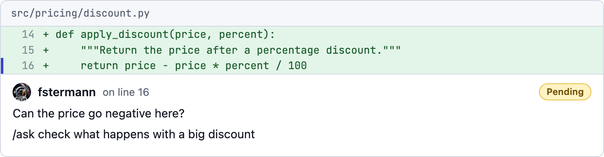
</picture>

<sub><i>run</i> <code>/pair-review</code> ↓</sub>

<picture>
  <source media="(prefers-color-scheme: dark)" srcset="assets/review-ask-after-dark.png">
  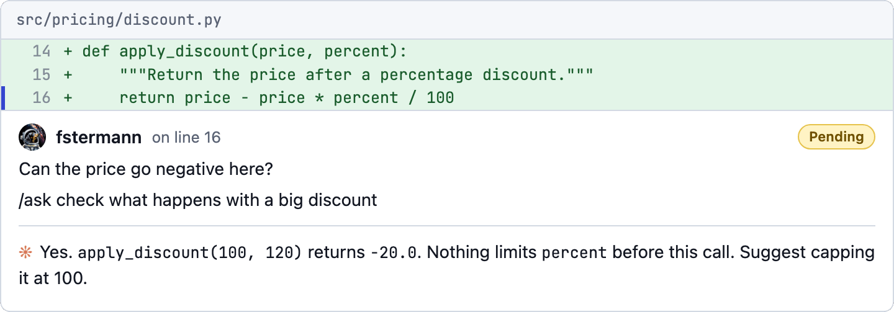
</picture>

Keep going with a normal reply in the thread:

<picture>
  <source media="(prefers-color-scheme: dark)" srcset="assets/review-ask-followup-dark.png">
  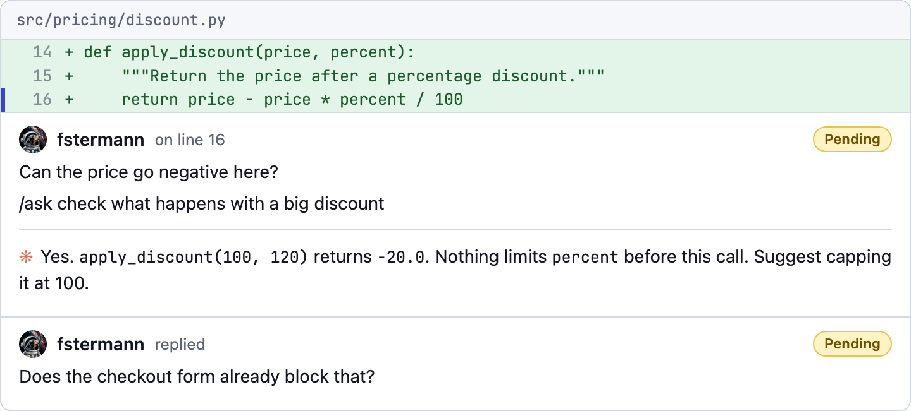
</picture>

<sub><i>run</i> <code>/pair-review</code> ↓</sub>

Claude folds the follow-up into the same comment and answers it. Nothing is replaced or summarized: the whole back-and-forth stays, you → Claude → you → Claude.

<picture>
  <source media="(prefers-color-scheme: dark)" srcset="assets/review-ask-iter2-dark.png">
  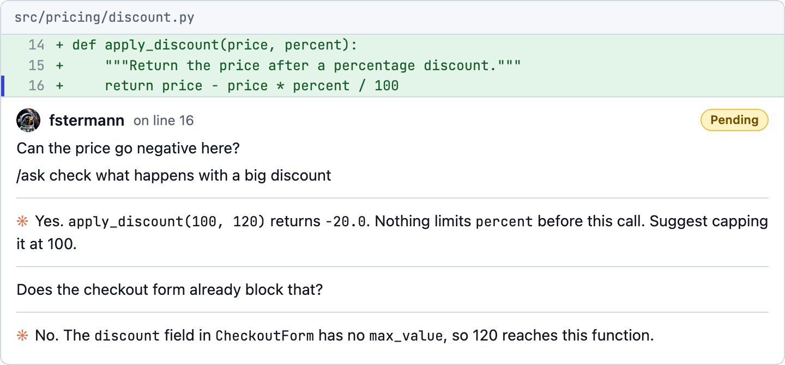
</picture>

When you're done, reply `/reply` (`/r`):

<picture>
  <source media="(prefers-color-scheme: dark)" srcset="assets/review-ask-reply-before-dark.png">
  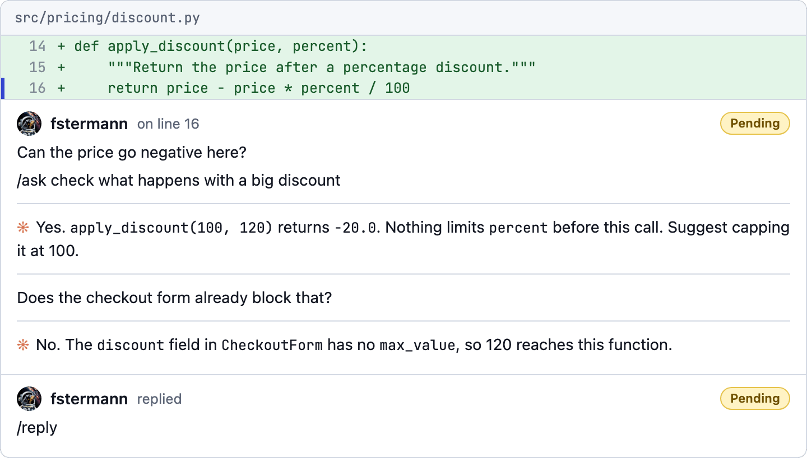
</picture>

<sub><i>run</i> <code>/pair-review</code> ↓</sub>

Claude collapses the transcript into one clean review comment, still marked `❊` so the author knows Claude drafted it, and still **Pending**.

<picture>
  <source media="(prefers-color-scheme: dark)" srcset="assets/review-ask-reply-after-dark.png">
  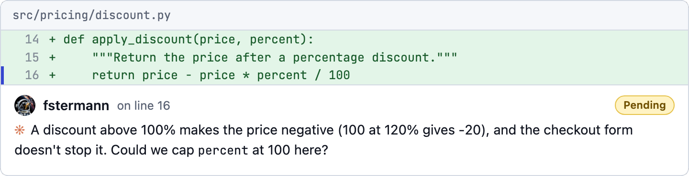
</picture>

### Answer a review of your PR

A reviewer asks for a change. Reply with `/implement` (`/i`) and a hint of how:

<picture>
  <source media="(prefers-color-scheme: dark)" srcset="assets/own-implement-before-dark.png">
  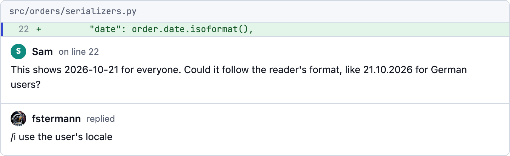
</picture>

<sub><i>run</i> <code>/pair-review</code> ↓</sub>

Claude changes the code, commits, pushes, and rewrites your reply into the answer the reviewer reads, citing the commit.

<picture>
  <source media="(prefers-color-scheme: dark)" srcset="assets/own-implement-after-dark.png">
  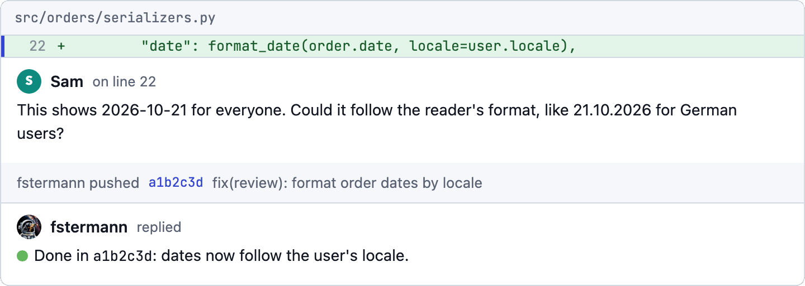
</picture>

In a thread you already tagged, just keep talking. Claude infers whether you asked a question or want a change:

<picture>
  <source media="(prefers-color-scheme: dark)" srcset="assets/own-followup-before-dark.png">
  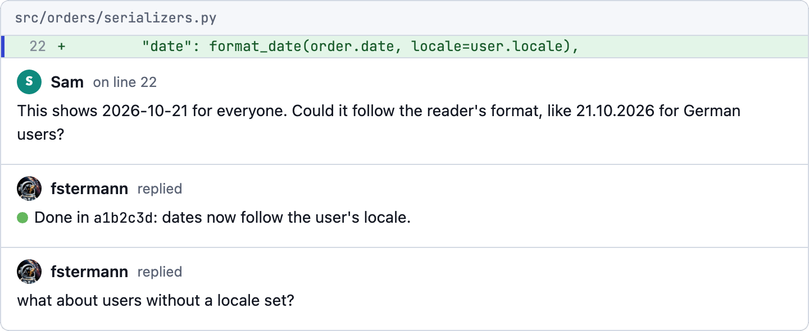
</picture>

<sub><i>run</i> <code>/pair-review</code> ↓</sub>

<picture>
  <source media="(prefers-color-scheme: dark)" srcset="assets/own-followup-after-dark.png">
  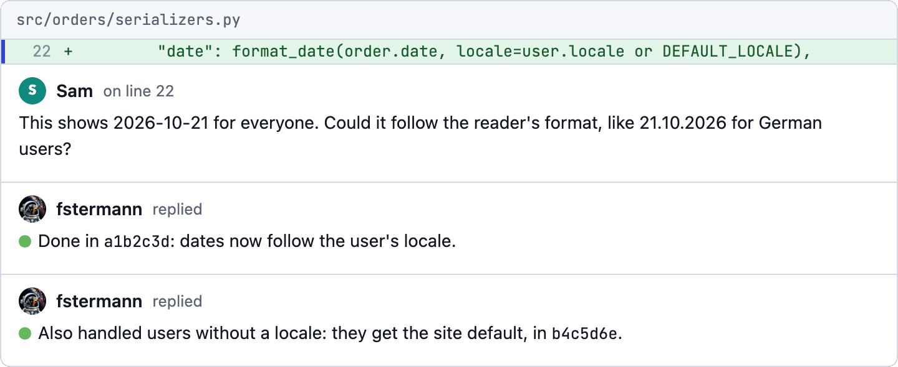
</picture>

To answer without changing code, use `/reply` (`/r`) with your reason in shorthand:

<picture>
  <source media="(prefers-color-scheme: dark)" srcset="assets/own-reply-before-dark.png">
  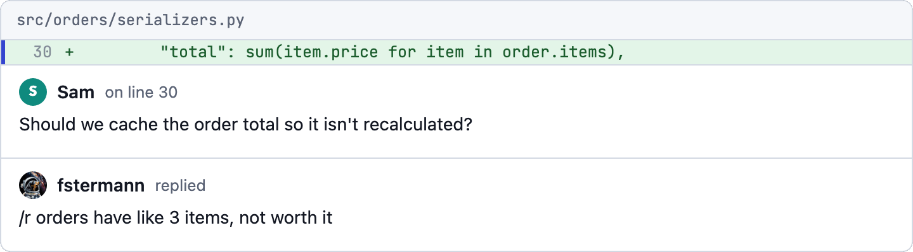
</picture>

<sub><i>run</i> <code>/pair-review</code> ↓</sub>

<picture>
  <source media="(prefers-color-scheme: dark)" srcset="assets/own-reply-after-dark.png">
  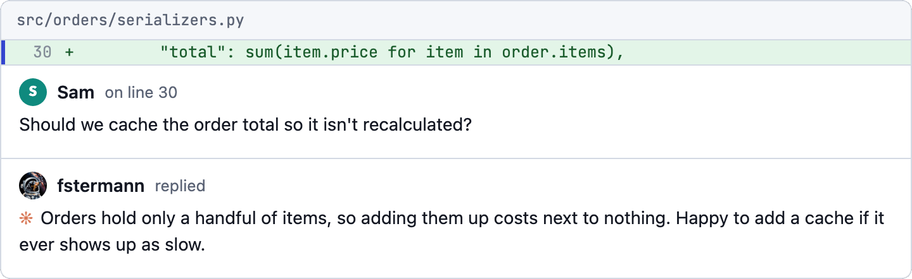
</picture>

### Notes on your own PR

Your own comments need no tag. Before asking for review, leave notes on your diff:

<picture>
  <source media="(prefers-color-scheme: dark)" srcset="assets/own-notes-before-dark.png">
  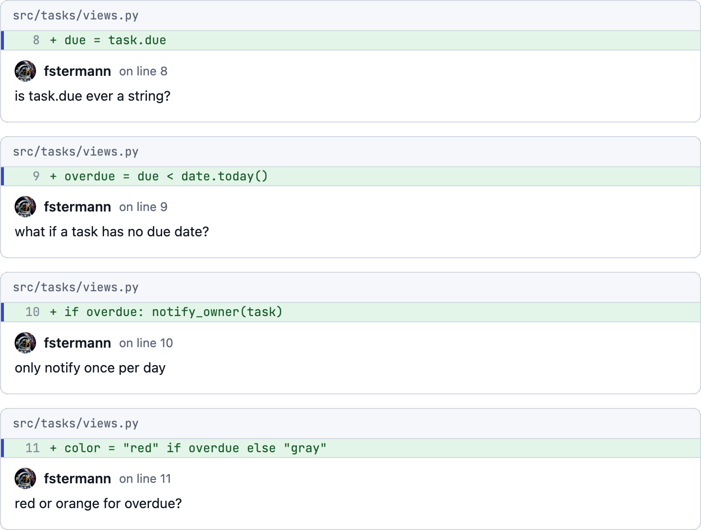
</picture>

<sub><i>run</i> <code>/pair-review</code> ↓</sub>

Each note gets a reply with a status glyph: ❊ answered, ● fixed with a commit, ◐ partly done with the reason, ○ a question back to you. Answer a ○ in the thread and the watcher picks it up.

<picture>
  <source media="(prefers-color-scheme: dark)" srcset="assets/own-notes-after-dark.png">
  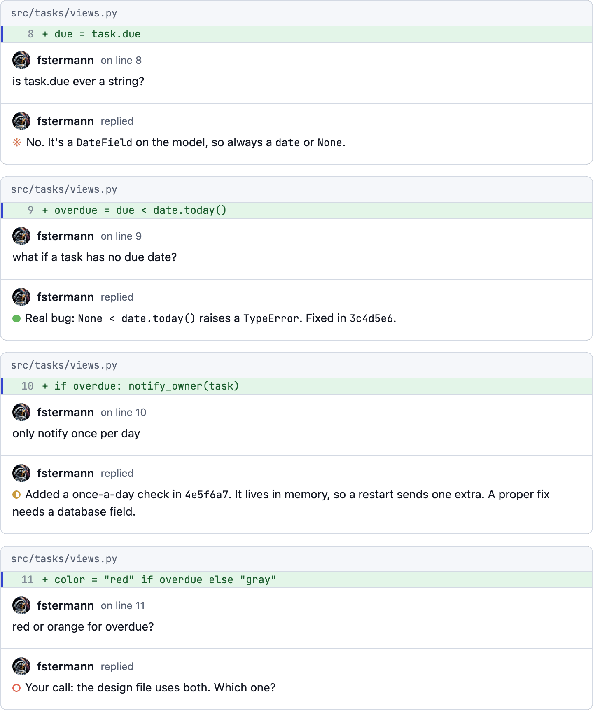
</picture>
